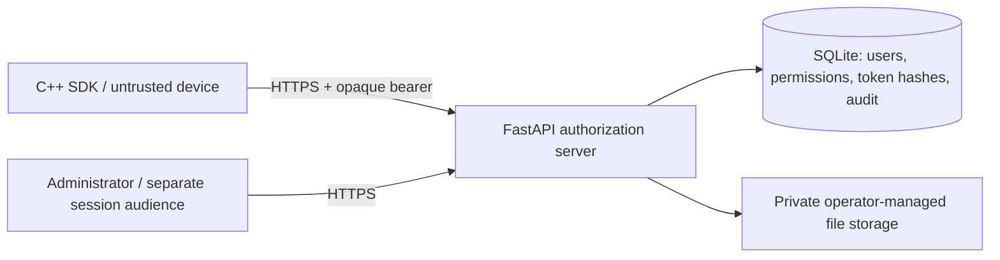
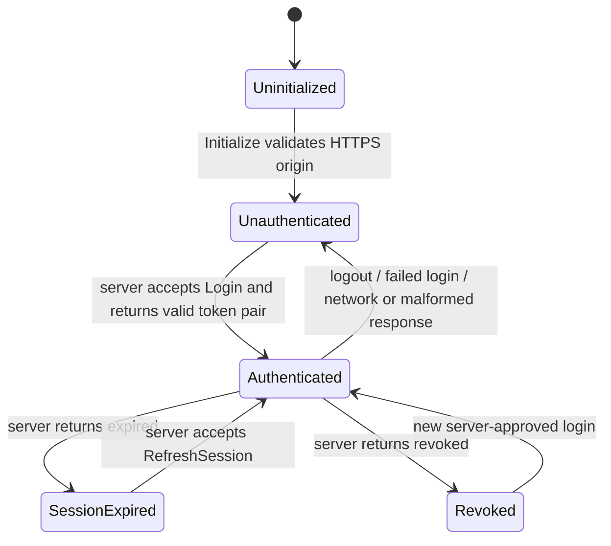

# Architecture and threat model

## Trust boundaries

The server is the authorization authority. Clients, hardware identifiers, local state, usernames, resource IDs, and JSON payloads are untrusted. There is no client master secret. The only credentials on the client are the user's password during login and random per-session tokens in memory. An attacker can patch the application or replace its SDK; that cannot manufacture server permissions. Once authorized bytes or variables reach a user's machine, they can be copied. No client licensing design can prevent that.

The browser administration console is a same-origin client of the management API. Its
HTML/CSS/JavaScript shell is public, while every data endpoint validates the administrator
audience and role independently. Tokens are held in page memory and requests are serialized
to avoid racing refresh rotation. A reload signs the browser out locally. Network failures,
revocation, and invalid responses clear credentials and remove the dashboard from view.
Untrusted values are HTML-escaped before rendering. The server sets a restrictive CSP,
frame denial, no-referrer, and no-store headers. Browser login is not a replacement for
administrator RBAC, nor does a hidden dashboard make data private. No third-party frontend
scripts, remote fonts, or credential-bearing cookies are used.

This is a single-application service. Application-wide variables have a NULL `user_id`; personal values use a server-managed user ID and take precedence. Each row carries its own required permission. Clients cannot submit role, subscription, user ID, permission, or audience to login or registration. Pydantic rejects extra fields. Admin authentication uses the same password storage but a distinct session audience; client sessions cannot access admin routes, and admin sessions cannot access client resources. The offline CLI provisions the initial administrator and resets passwords. Authenticated administrators can also create website-only administrators or explicitly grant website access to existing accounts. Website-only accounts cannot log in through the application or SDK; access changes revoke sessions. Public registration creates application users without website access. Password resets revoke sessions.

## Authentication and tokens

Passwords use Argon2id with 64 MiB memory, three iterations, and one lane. Unknown users perform a dummy verification; login failures have the same status and response for invalid usernames, passwords, account state, or password expiry. Validation errors never reflect submitted fields. This reduces enumeration but does not promise constant-time behavior across all server conditions. Registration reveals duplicates and can be disabled (default).

Access tokens have 256 bits of randomness and expire in five minutes. Refresh tokens have 384 bits and inherit the fixed 24-hour session deadline. Only SHA-256 hashes of these high-entropy values are stored. There are no JWT signing keys. Refresh runs in a serialized database transaction, consumes the old refresh token, deletes the old access token, and issues a new pair. Used refresh hashes remain as replay markers. Replaying one revokes the entire session, including its newest tokens. Parallel refreshes intentionally result in a single winner followed by family revocation. The SDK never races refreshes or retries them silently.

Every protected request joins access token, session, and current user records; it checks expiration, revocation, account status, password expiry, audience, and optional hardware hash. File and variable reads additionally require an unexpired subscription and either a direct permission or an active assigned license. Bound licenses require a matching session hardware hash. Expiry is checked against server Unix time. A correct password does not grant a subscription. The presence of a license key in the binary is never sufficient.

Registration returns success without tokens. SDK state is:

Any state can deny an operation. The server still validates independently when local state is Authenticated. Network failures, invalid TLS, malformed success responses, and partial transfers never produce protected results. A server outage therefore blocks protected operations. Availability attacks remain possible.

## Downloads

Files reside outside public web roots. Metadata accepts only a simple storage filename, resolves its path inside the configured private directory, and verifies size before opening. Private storage must be writable only by the trusted operator; resolved paths are not a defense against a malicious local filesystem administrator. No static-file mount, storage URL, grant URL, or token-bearing query string exists.

The server opens the file only after authorization, streams at most 1 MiB per chunk, and rechecks the session, permission, subscription, license, and file enablement between chunks. Revocation stops future chunks at the next check. A chunk already in transit cannot be recalled. The response declares Content-Length; curl rejects incomplete transfers and the SDK exposes no partial bytes. Deploy immutable files and replace them atomically rather than editing open files. An authorized completed download can always be redistributed by its recipient.

## Abuse, auditing, and limitations

Database-backed counters survive worker restarts and apply per peer and normalized username to login, per peer to registration/refresh, per account to license guessing, and per session to protected calls. Login usernames get ten attempts per five minutes; IP login limits default to thirty per minute. Successful logins count as well. Counters use fixed windows, so bursts near window boundaries are possible. Account throttling can be abused to deny login; use edge protection and operational monitoring. Password hashing occurs inside serialized SQLite transactions, favoring correctness over throughput. This service is for a modest single-node deployment, not a high-volume identity cluster.

Audit rows record identifiers, event, outcome, and server timestamp, excluding passwords, raw hardware IDs, license keys, access tokens, refresh tokens, and variable contents. Denied requests are recorded generically and sensitive-operation denials add context. These rows are not tamper-proof against a database administrator. Export them to a restricted independent log store for incident response. HTTP/body debug tracing must remain disabled. Rate-limited edge requests need edge logging without credentials.

Parameterized SQL prevents values from becoming query syntax. Request bodies are capped at 32 KiB; the edge must additionally enforce slow-client timeouts and connection limits. HTTPS is mandatory, with hostname and certificate verification in the SDK and no redirects. TLS, trusted proxy configuration, filesystem ACLs, backups, patching, and clock synchronization are deployment responsibilities.

Not included: MFA, email recovery, payments, distributed replication, managed secret storage, hardware attestation, end-user password-change UI, tamper-resistant audit storage, malware scanning, or automatic credential leak detection. Hardware binding is an optional spoofable anti-abuse signal. There is no promise of protection from a compromised server, administrator, OS, or trusted CA. Have the service and deployment independently reviewed before sensitive production use.

Implementation references: [libcurl certificate verification](https://curl.se/libcurl/c/CURLOPT_SSL_VERIFYPEER.html), [libcurl protocol restrictions](https://curl.se/libcurl/c/CURLOPT_PROTOCOLS_STR.html), and [FastAPI testing](https://fastapi.tiangolo.com/tutorial/testing/).

Owner approval is enforced by the backend on login, every admin request, and refresh. The normalized username in server-only AUTH_OWNER_USERNAME designates the owner (default gerry2.0). Only the owner may access user management or set web_access. New users start with web_approved=0. Approved members can manage workspace resources but cannot create or approve users. Changing approval revokes sessions, and public registration rejects the reserved owner username. The owner account must be provisioned offline; there is no fallback to the first administrator.
